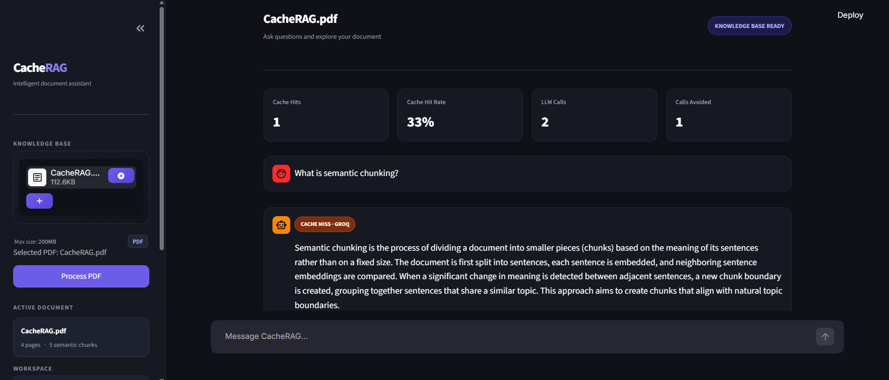
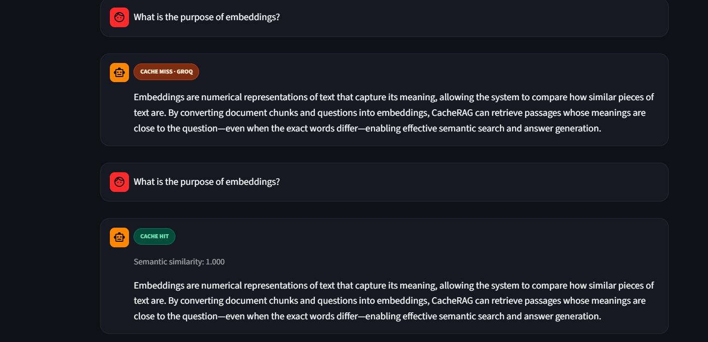

#  CacheRAG — RAG with Redis Semantic Caching

**CacheRAG** is a Retrieval-Augmented Generation (RAG) application that combines PDF-based question answering with Redis-powered semantic caching to reduce redundant LLM API calls and improve response efficiency.

Users can upload PDF documents and ask questions about their content. Before generating a new response using an LLM, CacheRAG checks Redis for semantically similar previously answered questions. If a sufficiently similar query is found, the cached answer is returned without making another LLM generation call.

---

## 📸 Application Preview

### 1. CacheRAG Dashboard



The dashboard provides an overview of the semantic caching system through four key metrics:

- **Cache Hits:** Number of queries served directly from the cache.
- **Cache Hit Rate:** Percentage of queries successfully served from the cache.
- **LLM Calls:** Number of times the Groq LLM was invoked.
- **Calls Avoided:** Number of LLM calls saved through cache hits.

The screenshot also demonstrates a query resulting in a **CACHE MISS**, where the system needs to retrieve relevant document context and generate a fresh response.

### 2. Semantic Cache Demonstration



This demonstrates how CacheRAG handles repeated questions:

- **First Query — CACHE MISS:** The question is not found in the semantic cache. The system retrieves relevant document chunks, generates an answer using the Groq LLM, and stores the result in Redis.
- **Second Query — CACHE HIT:** The same question is asked again. Redis identifies the previously stored result and returns the cached answer without invoking the LLM again.

This demonstrates how semantic caching avoids redundant LLM requests and improves response efficiency.

---

## ✨ Key Features

- **PDF-Based Question Answering:** Upload PDF documents and ask questions about their contents.
- **Semantic Chunking:** Divide document text into meaningful sections using embedding-based semantic boundaries.
- **Local Embeddings:** Generate text embeddings using Sentence Transformers.
- **Vector-Based Retrieval:** Retrieve relevant document chunks using embedding similarity.
- **Redis Semantic Cache:** Identify previously answered questions using vector similarity instead of relying on exact text matches.
- **Reduced LLM Calls:** Reuse cached responses when a sufficiently similar question is detected.
- **Context-Grounded Responses:** Generate answers using relevant document context.
- **Cache Performance Metrics:** Track cache hits, hit rate, LLM calls, and calls avoided.
- **Interactive Interface:** Streamlit-based interface for document uploads and conversations.

---

## 🏗️ System Architecture

```text
                  PDF DOCUMENT
                       |
                       v
                PDF Text Extraction
                       |
                       v
                 Semantic Chunking
                       |
                       v
                Generate Embeddings
                       |
                       v
              Prepare Document Chunks
                       |
                       |
                  USER QUESTION
                       |
                       v
              Generate Query Embedding
                       |
                       v
              REDIS SEMANTIC CACHE
                       |
                Vector Similarity
                       |
                +------+------+
                |             |
             CACHE HIT     CACHE MISS
                |             |
                v             v
          Return Cached   Retrieve Relevant
             Answer       Document Chunks
                              |
                              v
                          GROQ LLM
                              |
                              v
                         Generate Answer
                              |
                              v
                       Store in Redis
                              |
                              v
                         Return Answer
```

---

## ⚙️ How It Works

CacheRAG follows a two-stage process combining Retrieval-Augmented Generation and semantic caching.

### 1. Document Processing

1. The user uploads a PDF document.
2. PyMuPDF extracts the text from the document.
3. LlamaIndex's `SemanticSplitterNodeParser` divides the extracted text into semantically meaningful chunks.
4. Sentence Transformers generate embeddings for the document chunks.
5. These chunks and their embeddings are prepared for similarity-based retrieval.

### 2. Query Processing

When a user submits a question:

1. The question is converted into an embedding using Sentence Transformers.
2. Redis Vector Sets search for the most semantically similar cached question.
3. The similarity score is compared against a configurable threshold.

### 3. Cache Hit

If a sufficiently similar cached question is found:

- The corresponding cached answer is retrieved from Redis.
- The cached response is returned directly to the user.
- No new Groq LLM generation call is required.

### 4. Cache Miss

If no sufficiently similar cached question is found:

- The query is compared against document chunk embeddings.
- The most relevant document chunks are retrieved.
- The retrieved context and user question are sent to the Groq LLM.
- The generated answer is returned to the user.
- The question embedding and generated answer are stored in Redis for future reuse.

---

## 🧠 Understanding Semantic Caching

Traditional caching generally relies on exact query matches. However, different questions can express the same meaning.

For example:

| Original Question | Similar Question |
|---|---|
| What is semantic chunking? | How does the system divide text based on meaning? |
| What is the purpose of embeddings? | Why are text embeddings generated? |
| What role does Redis play? | Why is Redis used in this architecture? |

CacheRAG converts questions into vector embeddings and uses Redis Vector Sets to identify semantically similar queries.

When the similarity score meets the configured threshold, the system retrieves the previously generated answer instead of invoking the LLM again.

This makes caching more flexible than traditional exact-match caching.

---

## 🛠️ Technology Stack

| Component | Technology |
|---|---|
| Frontend | Streamlit |
| Programming Language | Python |
| PDF Processing | PyMuPDF |
| Semantic Chunking | LlamaIndex |
| Embedding Model | Sentence Transformers |
| Model | all-MiniLM-L6-v2 |
| Vector Search | Redis Vector Sets |
| Cache Storage | Redis |
| LLM API | Groq |
| Numerical Operations | NumPy |

---

## 📂 Project Structure

```text
CacheRAG/
│
├── app.py
├── requirements.txt
├── .gitignore
│
├── services/
│   ├── cache_service.py
│   ├── chunking_service.py
│   ├── embedding_service.py
│   ├── llm_service.py
│   └── retrieval_service.py
│
├── ss/
│   ├── img1.png
│   └── img2.png
│
├── test_cache.py
├── test_redis.py
└── test_vector.py
```

---

## 🚀 Getting Started

### Prerequisites

- Python 3.10+
- Redis 8.x with Vector Sets support
- Groq API key

### 1. Clone the Repository

```bash
git clone https://github.com/TanmayShelar43/CacheRAG.git

cd CacheRAG
```

### 2. Create a Virtual Environment

```bash
python -m venv venv
```

Activate the environment:

**Windows PowerShell**

```powershell
.\venv\Scripts\Activate.ps1
```

**Linux / macOS**

```bash
source venv/bin/activate
```

### 3. Install Dependencies

```bash
pip install -r requirements.txt
```

### 4. Configure Environment Variables

Create a `.env` file in the project root directory:

```env
GROQ_API_KEY=your_groq_api_key
```

Replace `your_groq_api_key` with your actual Groq API key.

### 5. Start Redis

Ensure Redis 8.x is running and accessible at:

```text
localhost:6379
```

CacheRAG uses Redis Vector Sets, so make sure your Redis installation supports the `VADD` and `VSIM` commands.

### 6. Run the Application

```bash
streamlit run app.py
```

Open the local URL displayed in your terminal to access CacheRAG.

---

## 🧪 Testing

The project includes individual test scripts to verify Redis connectivity, vector operations, and semantic caching.

Run the tests using:

**Redis Connection Test**

```bash
python test_redis.py
```

**Redis Vector Set Test**

```bash
python test_vector.py
```

**Semantic Cache Test**

```bash
python test_cache.py
```

---

## 🔮 Future Improvements

- Cache hit ratio and performance analytics.
- Average response latency measurement.
- Tracking LLM API calls avoided.
- Estimated API cost savings.
- Evaluation of semantic similarity thresholds and cache accuracy.
- Support for multiple document sessions.
- Improved cache lifecycle management.

---

## 👨‍💻 Author

**Tanmay Shelar**

- GitHub: [@TanmayShelar43](https://github.com/TanmayShelar43)
- Project Repository: [CacheRAG](https://github.com/TanmayShelar43/CacheRAG)

---
